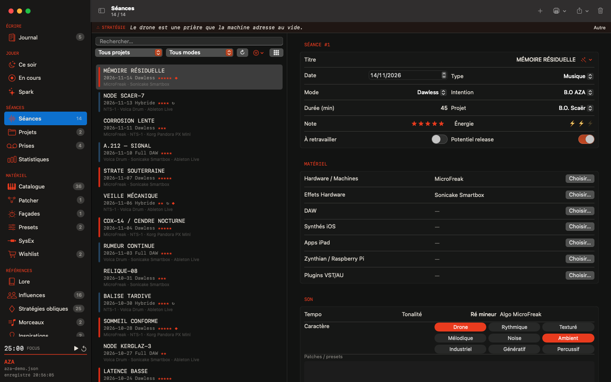
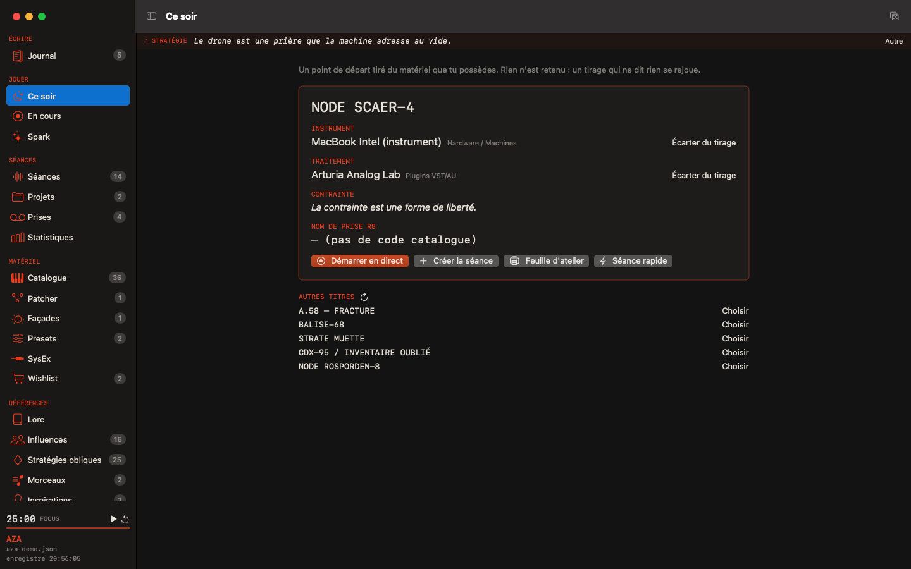
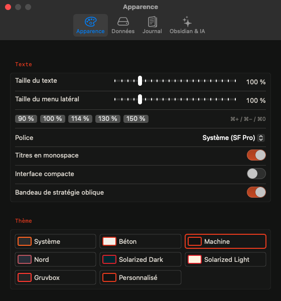

# Journal de Sessions AZA

> Application de documentation et de performance musicale pour le projet **AZA** —
> univers de fiction dystopique dont les sessions de création constituent la bande originale.

**App macOS** · [Télécharger](https://github.com/obareau/aza-sessions/releases/latest) · [Code de l'app](macos/) · [App web (historique)](#application-web-flask--historique)



---

## App native macOS

Le journal tourne désormais en **app native macOS (SwiftUI)**, sans serveur : toutes les données
tiennent dans **un seul fichier JSON** (`~/Documents/AZA Sessions/aza-sessions.json`), sauvegardé à
chaque modification, avec 5 copies datées. Toutes les fonctions de l'app web Flask ont été portées.

### Installer

1. Télécharger **`AZA-macos-vX.Y.Z.dmg`** depuis les [releases](https://github.com/obareau/aza-sessions/releases/latest)
   et glisser AZA dans Applications.
2. Au premier lancement : **clic droit → Ouvrir** (app signée ad-hoc, non notariée).

macOS 13 Ventura ou plus récent · binaire universel (Apple Silicon et Intel).
Pour reprendre une base de l'app web : **Fichier › Importer une base sessions.db…**

### Journal

Un journal personnel dans l'esprit de l'app Journal d'Apple — qui n'existe pas sur macOS 13 —, relié à l'univers AZA :
entrées datées avec **photos et notes audio**, **état d'esprit** (7 crans, ressentis, ce qui y est lié), signets,
**suggestions d'écriture** tirées de tes séances récentes, presets, patches, stratégies obliques et citations du lore,
**calendrier**, **aperçu** (séries, mots écrits, ressentis), recherche et filtres, **verrou Touch ID** et rappel quotidien.
Chaque entrée peut se lier à des séances, du matériel, un patch ou une page du lore, et s'écrire dans le vault Obsidian.

| | |
|---|---|
|  |  |
| **Journal** — suggestions, fil, photo, note audio, état d'esprit | **Calendrier** — les jours écrits, avec leurs photos et leur humeur |

### En images

| | |
|---|---|
|  |  |
| **Patcher** — câbles audio / MIDI / CV / USB, minimap, lié en direct au catalogue | **Ce soir** — un instrument, un traitement, une contrainte, un titre, un nom de prise |
|  |  |
| **Statistiques** — séries, activité de l'année, tendances | **Catalogue** — fiche, carnet d'instrument, façade, codes de prise |
|  |  |
| Les **6 thèmes** de l'app web (ici Béton) + un thème personnalisé | **Réglages** — taille du texte et du menu, police, thème |

### Ce qu'elle fait

- **Écrire** : journal personnel (photos, sons, état d'esprit, suggestions, calendrier, aperçu, verrou Touch ID).
- **Jouer** : Ce soir (tirage), séance En cours avec chrono, Spark, séance rapide (⇧⌘N).
- **Journal** : séances (tous les champs, nom de prise Zoom R8, titres dans l'esthétique AZA, filtres),
  projets, registre des prises, statistiques.
- **Matériel** : catalogue (carnet d'instrument, façade, proposition de codes), **patcher**, relevés de
  façade, presets, **SysEx DX7 / Volca FM** via CoreMIDI, wishlist.
- **Références** : lore (lu depuis le vault Obsidian, rien n'est copié), influences, stratégies
  obliques, morceaux, inspirations, samples, MiRack.
- **Sorties** : fiches imprimables A4 (séance, rappel, feuille d'atelier, formulaire terrain, fiches
  matériel) en impression ou PDF ; export Markdown, CSV, JSON ; écriture dans le vault Obsidian.
- **Récap IA** via Ollama (serveur et modèle réglables ; les échecs sont toujours affichés).
- Pomodoro, bandeau de stratégie oblique, aide clavier (⌘/).

### Construire depuis les sources

```bash
bash macos/build_app.sh            # → macos/build/AZA.app (avec les seuls Command Line Tools)
bash macos/build_app.sh --install  # copie aussi dans ~/Applications
```

Détails techniques : [`macos/README.md`](macos/README.md).

---

## Application web (Flask) — historique

> L'app web ci-dessous reste dans le dépôt pour mémoire. **Version : v3.15.1** ·
> [Changelog](CHANGELOG.md) · [Live →](https://sessions.robotariis.com)

### Ce que c'est

**Journal de Sessions AZA** est un outil personnel en trois parties :

1. **Carnet de bord musical** — documente chaque session de création (machines, patches, tempo,
   influences, notes, rating) et les organise en projets.

2. **⬡ Patcher** — mind map SVG interactif pour visualiser et documenter le routing signal
   entre machines hardware, effets, DAW, iOS et plugins.

3. **Prompteur Dawless** — scripts de set avec minutage, noms de patch et instructions.
   Vue performance plein écran avec transport DAW, horloge décompte, barre LED, avance auto.

L'application tourne **localement** (`python app.py`) ou en **cloud** sur Fly.io.

---

## Démarrage rapide

```bash
pip install -r requirements.txt
python app.py
# → http://localhost:5000
```

Pour le déploiement :

```bash
# Sur Roblab (bare metal, systemd + Gunicorn — plus de Fly.io depuis 2026)
git pull && sudo systemctl restart aza-sessions
# → https://sessions.robotariis.com
```

---

## Fonctionnalités

### Sessions musicales
| Fonction | Description |
|---|---|
| Créer / Éditer / Supprimer | Formulaire complet avec titre, date, durée |
| Copier setup | Nouvelle session pré-remplie depuis une existante |
| Liaison sessions | Chaîne de travail sur un même morceau |
| Export Markdown | Compatible Obsidian — individuel ou global |
| Export PDF | Formulaire vierge A4 imprimable |
| Export → vault Obsidian | Push direct via chemin configuré |

### Organisation
| Fonction | Description |
|---|---|
| Projets | Regrouper plusieurs sessions avec couleur et description |
| Tags | Libres, cliquables pour filtrer |
| Filtres temps réel | Texte, mode, note |
| Statistiques | Dashboard Chart.js — machines, influences, timeline mensuelle |

### ⬡ Patcher — v3.5
| Fonction | Description |
|---|---|
| Canvas SVG interactif | Nœuds drag & drop, connexions Bézier avec flèches typées |
| Types de nœuds | machine · effet · daw · synth_ios · plugin · free + **types custom** |
| Types de signal | audio (orange) · midi (bleu) · cv (vert) · usb (violet) · autre |
| Icônes + note courte | Affichées dans chaque nœud sur le canvas |
| Barre de propriétés | Label, type, signal, note — éditables en bas, sélection simple clic |
| Panneau catalogue | Picker latéral — ajouter depuis le catalogue en un clic |
| Import depuis session | Crée automatiquement les nœuds depuis une session liée |
| **Export → Session** | Bouton `→ Session` : pré-remplit le formulaire session + signal_routing depuis le graphe |
| Types custom | synth_android, fx_android, etc. — couleur auto par hash, icône ◈ |
| Autosave | AJAX 1,5 s |
| Mode Nav / Édition | Toggle mobile : navigation page ou édition canvas (pinch-to-zoom, pan 1 doigt) |
| Export Mermaid | `.md` avec `graph LR`, flèches typées, tables nœuds/connexions |
| Export SVG | Standalone, CSS vars résolus, polices embarquées |
| Export PDF | Via `window.print()` paysage |
| Export / Import JSON | Format portable `from_index/to_index` — échange entre instances |
| **Dupliquer un layout** | Copie nœuds + connexions en un clic depuis la liste |
| **Snap-to-grid** | Grille 20 px optionnelle — touche `G`, persistée en localStorage |
| **Connexions multi-type** | Plusieurs câbles entre les mêmes nœuds — offset perpendiculaire automatique |
| **Minimap** | Vue d'ensemble 180×110 px — touche `M`, clic pour naviguer |

### ⎍ SysEx Loader & Bank Editor — v3.2

| Fonction | Description |
|---|---|
| Loader | Charger un `.syx` DX7/Volca FM par glisser-déposer ou file picker |
| Détection MIDI | `navigator.requestMIDIAccess({sysex:true})` — liste toutes les sorties |
| Test connexion | Phrase C3→C5 (arpège majeur 3 octaves) pour confirmation sonore |
| Preview patches | Noms des 32 patches parsés depuis le bulk dump DX7 (packed 128 bytes) |
| Canal MIDI | Réglable 1-16, byte `0n` réécrit dans le header SysEx avant envoi |
| Envoi | `output.send(bytes)` + toast confirmation |
| Librairie | Sauvegarder / charger / télécharger / supprimer des banks (BLOB SQLite) |
| **Bank Editor** | Assembler une bank custom depuis plusieurs sources |
| Source → Custom | `[+]` par patch ou `[+ Tous]` — swapper la source sans perdre la bank |
| Réordonnancement | ↑ ↓ ✕ par slot — 32 slots, vides comblés par init voice |
| Export .syx | Build bulk dump DX7 client-side + checksum 2's complement |
| Envoi direct | Web MIDI depuis l'éditeur sans passer par le loader |

### ⬡ Prompteur Dawless
| Fonction | Description |
|---|---|
| Scripts de set | Titre, description, cues (temps · patch · action · couleur) |
| Vue performance | Trois zones prev/current/next, plein écran |
| Transport DAW | ⏮ Rewind · ⏹ Stop · ▶ Play/Pause |
| Horloge | 48px — décompte cue (auto) ou chrono global (manuel) |
| Barre LED | Segments 22px, clignotement <10s/<5s, hauteur réglable |
| Mode auto / manuel | Avance automatique ou scrub barre / Espace / swipe |
| Zoom police | A+ / A− (40–250 %) |
| Import / Export | JSON structuré + Markdown Obsidian |

### Catalogue & Références
- Machines hardware, effets, DAW, synthés iOS, plugins — **classés par fabricant**
- **Types libres** (`synth_android`, `fx_android`…) — le patcher suit automatiquement
- **Ajout inline** depuis le formulaire session — modal AJAX sans perdre le contexte
- Influences (artistes, labels)
- **Stratégies Obliques AZA** — contraintes créatives aléatoires, style Brian Eno

### Ergonomie
- **Autosave brouillon** — formulaire nouvelle session restauré si on revient
- Zoom global A+ / A− — persisté en localStorage
- Menu hamburger sur mobile/iPad
- 6 thèmes : Béton · Machine · Nord · Solarized · Gruvbox · Dracula

---

## Stack technique

| Composant | Technologie |
|---|---|
| Backend | Python 3 / Flask |
| Base de données | SQLite (`sessions.db`) |
| Hébergement | Fly.io (Docker + Gunicorn) ou local |
| Templates | Jinja2 |
| CSS | Vanilla — zéro framework externe |
| Graphiques | Chart.js |
| Patcher | SVG — Bézier, markers, drag & drop vanilla JS |
| Typographie | IBM Plex Mono / IBM Plex Sans |
| Thèmes | Béton · Machine · Nord · Solarized · Gruvbox · Dracula |

---

## Structure du projet

```
app.py                      # Launcher — init_db, blueprints
wsgi.py                     # Point d'entrée Gunicorn — init_db + backup au démarrage
Dockerfile                  # Résiduel : servait au build Fly.io, plus utilisé
core/
  db.py                     # get_db() partagé
  init_db.py                # init_db(db_path) + migrations ALTER TABLE
  oblique.py / constants.py
sessions/                   # Blueprint sessions — CRUD, exports, search
catalogue/                  # Blueprint catalogue matériel
patcher/                    # Blueprint ⬡ Patcher
  engine.py                 # PatcherEngine — save, import session/catalogue, export
  api.py                    # Routes : view, save, import JSON, export Mermaid
obliques/ influences/ spark/ dim/
templates/
  patcher_list.html         # Liste layouts + form import JSON
  patcher_view.html         # Canvas SVG interactif complet
  prompter_play.html        # Vue performance plein écran
  ...
CHANGELOG.md
sessions.db                 # NON VERSIONNÉ
```

---

## Base de données

| Table | Description |
|---|---|
| `sessions` | Sessions musicales — table principale (30+ champs) |
| `projects` | Projets — regroupement de sessions |
| `prompter_scripts` | Scripts prompteur — JSON cues |
| `patch_layouts` | Layouts patcher — nom, session liée |
| `patch_nodes` | Nœuds — label, position, type, couleur, note |
| `patch_connections` | Connexions — from/to, signal_type, label, note |
| `catalogue` | Matériel + types libres |
| `influences` | Artistes et labels |
| `obliques` | Stratégies créatives |

Les migrations sont automatiques via `ALTER TABLE … ADD COLUMN` dans `init_db()`.

---

## Déploiement Fly.io

```bash
fly launch                          # première fois — crée l'app + volume
fly deploy                          # mise à jour
fly logs --app robotariis-sessions  # logs
```

La base SQLite vit dans un volume persistant monté sur `/data`.

---

## Roadmap

### v3.3.x — Patcher : polish & puissance
- Connexions multi-type simultanées (audio + MIDI sur le même câble)
- Snap-to-grid optionnel
- Dupliquer un layout
- Minimap / vue d'ensemble sur les grands patches

### v3.4.x — Sessions : enrichissement
- Lecteur audio intégré (Web Audio API, waveform)
- BPM / tonalité dans les filtres de recherche

### v3.5.x — Vue Projet & Timeline
- Timeline visuelle des sessions par projet (Chart.js ou SVG)
- Page projet dédiée — durée totale, statut WIP / released
- Lien patch ↔ plusieurs sessions (relation 1-n)

### v4.x — Intégrations
- Export direct vers Obsidian via plugin AZA (WebSocket ou dossier watch)
- API REST légère pour scripting externe (Shortcuts iOS, mobile)
- PWA / offline-first

---

*Projet personnel — Olivier, Scaër, Bretagne — 2026*  
*La machine ne ment pas. Elle déforme.*
