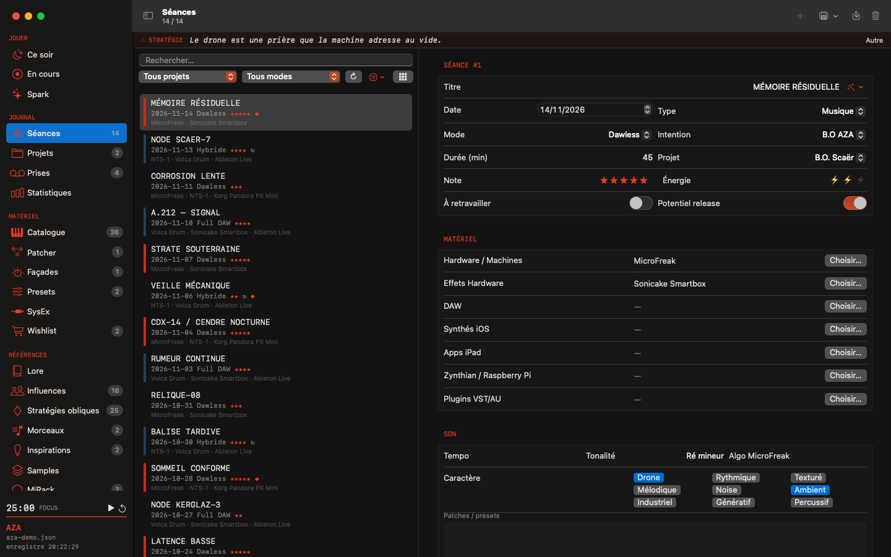

# AZA — app macOS native



Journal de Sessions AZA en SwiftUI, sans serveur. Les données vivent dans un seul
fichier JSON : `~/Documents/AZA Sessions/aza-sessions.json` (5 sauvegardes datées
dans `backups/` à côté, prises à l'ouverture et avant chaque import).

```bash
bash macos/build_app.sh            # → macos/build/AZA.app (universel, signé ad-hoc)
bash macos/build_app.sh --install  # copie aussi dans ~/Applications
```

Construit avec les seuls Command Line Tools : pas de `@State` (macro SwiftUI
indisponible sans Xcode), l'état local passe par `@Local` (`Sources/AZA/Local.swift`).

- `Sources/AZACore` — modèle, stockage JSON, nom de prise R8, export Markdown, import `sessions.db`
- `Sources/AZA` — l'app :
  - Jouer : Ce soir (tirage instrument + traitement + contrainte + titre + prise), séance En cours (chrono), Spark
  - Journal : Séances, Projets, Prises (registre des noms R8), Statistiques
  - Matériel : Catalogue (fiche, carnet d'instrument, façade ; proposition de codes), Patcher, Façades & relevés, Presets, Wishlist
  - Patcher (⇧⌘P) : nœuds depuis le catalogue ou une séance, câbles audio/MIDI/CV/USB (mode câble : C),
    grille G, minimap M, tout afficher F, pincer pour zoomer ; exports Mermaid, SVG, PNG, JSON portable (format web) ; → séance
    Lien vivant avec le catalogue : un nœud lié suit sa fiche (nom, type, couleur de type) ; une fiche supprimée
    délie le nœud ; un nœud libre au nom d'une fiche s'y relie (sauf « Délier »). Panneau catalogue (K) à droite.
  - SysEx (CoreMIDI) : loader .syx (glisser-déposer, noms des 32 voix DX7, contrôle du checksum), sortie + canal
    réécrit dans l'en-tête Yamaha, phrase de test, librairie ; éditeur de banque 32 voix (renommer, réordonner,
    export .syx, envoi). Envoi par MIDISendSysex, cadencé par CoreMIDI.
  - Références : Lore (lecture du vault Obsidian : sections, recherche, chronologie, citations ;
    rien n'est copié dans le JSON), Influences, Stratégies obliques, Morceaux, Inspirations, Samples, MiRack
- Fiches imprimables (A4, aperçu → Imprimer… ou PDF) : fiche de séance, fiche de rappel (chaîne dans l'ordre
  du signal + façades relevées), feuille d'atelier (potards à noircir au stylo), formulaire terrain vierge,
  fiches matériel en paysage. `aza-check --sheets <dossier>` écrit des exemples en HTML.
- Réglages (⌘,) : taille du texte (⌘+ / ⌘− / ⌘0), police, thèmes de l'app web
  (Béton, Machine, Nord, Solarized, Gruvbox, personnalisé), interface compacte, emplacement du fichier JSON
- `Sources/aza-check` — auto-test, lancé par `build_app.sh`

Reprendre les données de l'app Flask : **Fichier › Importer une base sessions.db…**
(lecture seule de la base ; le JSON courant est sauvegardé avant d'être remplacé).

Aussi : séance rapide (⇧⌘N), récap IA via Ollama (serveur et modèle dans Réglages › Obsidian & IA, échecs
toujours affichés), export vers le vault Obsidian (une séance ou toutes), export CSV, propositions de titres,
filtres (type, intention, note, mois), bandeau de stratégie oblique, pomodoro, aide clavier (⌘/), À propos.

Toutes les fonctions de l'app web sont portées.

## Captures d'écran

Les images de `docs/screenshots/` sont produites par l'app elle-même, sur un jeu de démo :

```bash
swift build --package-path macos
BIN=$(swift build --package-path macos --show-bin-path)
"$BIN/aza-check" --demo /tmp/aza-demo/aza-demo.json
"$BIN/AZA" -snapshotDir /tmp/aza-shots -dataFile /tmp/aza-demo/aza-demo.json -theme machine
```

L'app photographie sa propre fenêtre (aucune autorisation d'enregistrement d'écran) puis quitte.
Les arguments `-dataFile`, `-theme`… ne passent que par le domaine d'arguments : rien n'est écrit
dans les préférences.
